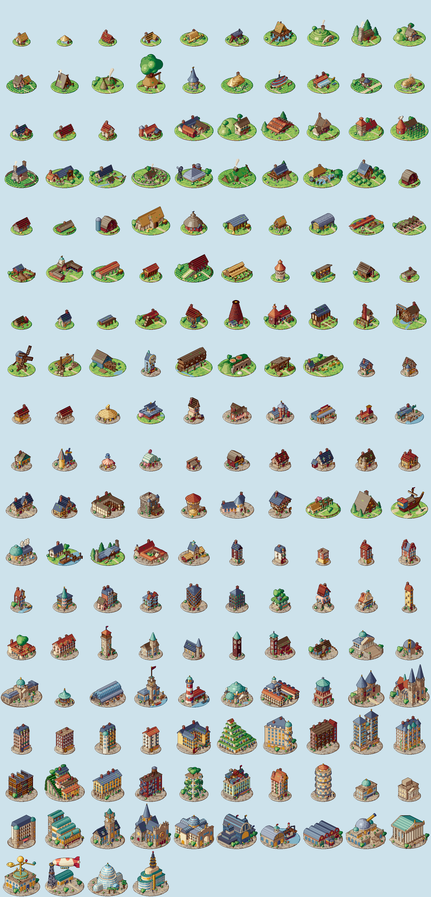
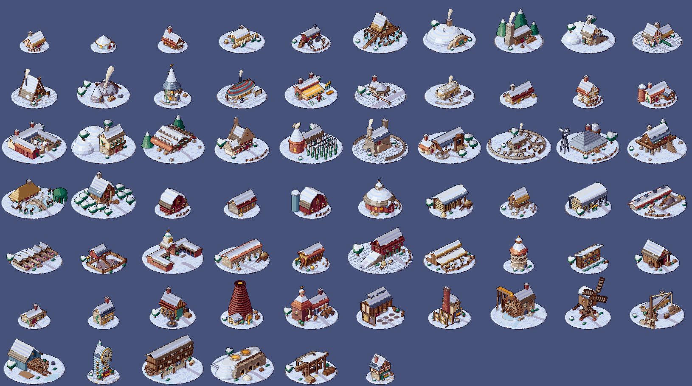

# Pixel Buildings

Free pixel-art buildings for your game: cozy, hand-designed and warm, from a rural hut to a city landmark. Every building is its own design, with a summer version and a winter version at dusk.




Browse them by category: open `index.html` through any web server, or use the GitHub Pages site.

## What's in it

| Folder | Contents |
|---|---|
| `buildings/<id>/` | One folder per building: `summer.png`, `summer.json`, `winter.png`, `winter.json` |
| `effects/` | A looping falling-snow overlay |
| `buildings.json` | An index of every building: id, name, category and files |
| `index.html` | The browsing website |
| `preview/` | Contact sheets |

## Using a building

Each PNG is a column of 8 views, one per compass angle, seen from a 30-degree camera. Its JSON gives the rectangle of each view and the anchor:

```json
{
 "image": "summer.png",
 "frame_size": [78, 71],
 "anchor": [39, 48],
 "angles": {"s": {"x": 0, "y": 0, "w": 78, "h": 71}, "se": {"x": 0, "y": 71, "w": 78, "h": 71}}
}
```

- Pick a view from `angles`. For a fixed camera, `se` is a good default.
- `anchor` is the pixel inside the frame that sits on the ground at the building's centre. Place that pixel at the building's position, and sort by it for depth.
- Use nearest-neighbour filtering and whole-number zoom, so that pixels stay sharp.

In Godot 4:

```gdscript
var meta = JSON.parse_string(FileAccess.get_file_as_string("res://buildings/01-08-woodcutters-log-cabin/summer.json"))
var view = meta["angles"]["se"]
var sprite := Sprite2D.new()
sprite.texture = preload("res://buildings/01-08-woodcutters-log-cabin/summer.png")
sprite.region_enabled = true
sprite.region_rect = Rect2(view["x"], view["y"], view["w"], view["h"])
sprite.centered = false
sprite.offset = -Vector2(meta["anchor"][0], meta["anchor"][1])
sprite.texture_filter = CanvasItem.TEXTURE_FILTER_NEAREST
```

## Falling snow

`effects/snowfall.png` is a looping overlay. Draw it above winter buildings, using the frames and timing in `effects/snowfall.json`.

## Licence

[CC0 1.0](LICENSE): public domain. Use these buildings in any project, free or commercial, and change them however you like. No credit is needed, though it's always welcome.
